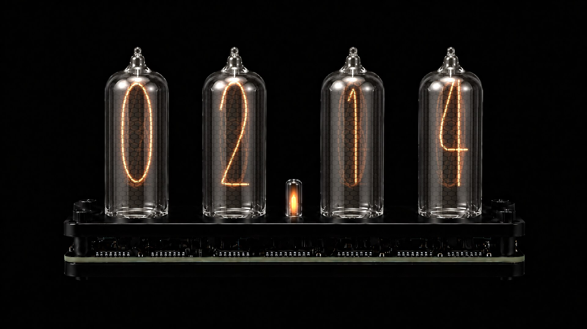
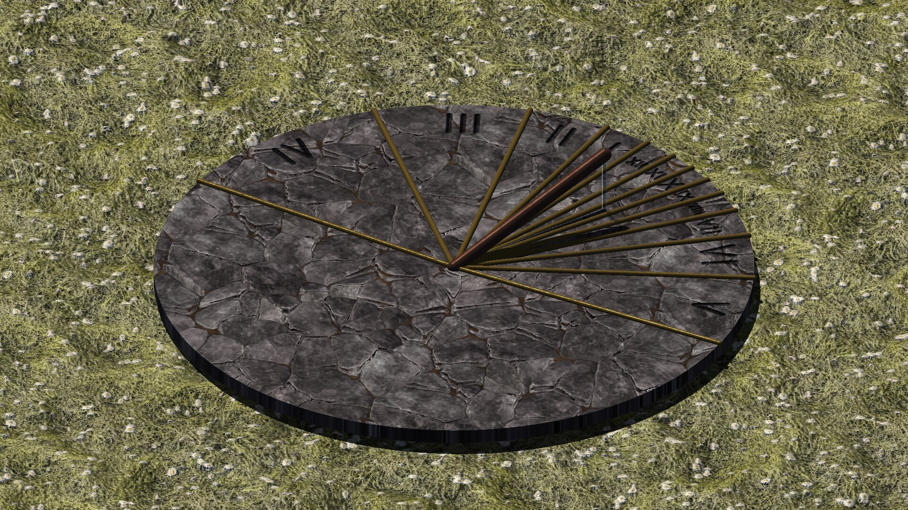
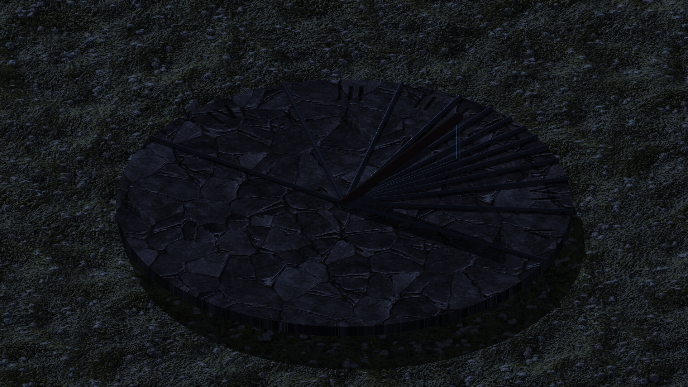

# nixalarm

`nixalarm` is a small Linux alarm utility. It shows the current local time in a configurable clock window and plays a chosen audio source at a scheduled local time.

Clock styles include seven-segment digits, a photoreal nixie tube face, an analog dial, and ray-traced sundial and moondial faces that follow the real sun and moon. Sound sources include a built-in generated tone, local audio files, internet streams, MIDI files, and RTL-SDR radio through `rtl_fm`. The default install stays offline: it rings the generated tone and contacts nothing until configured otherwise.

## Screenshots

| `nixie` | `sinnoh_green` |
|---|---|
|  |  |

| `auto_dial` (day, sundial) | `auto_dial` (night, moondial) |
|---|---|
|  |  |

## Quick start

Build the program, then schedule an alarm:

```sh
cmake -S . -B build
cmake --build build
./build/nixalarm 07:30
```

The `build/` directory is generated and local, not source. From a plain build tree the command is `./build/nixalarm`; after install or packaging it is `nixalarm`. Full build instructions live in [docs/contributing/build.md](docs/contributing/build.md).

Expected: the terminal reports the armed time and a clock window opens. If 07:30 already passed today, the alarm is scheduled for tomorrow. While ringing, tap Space to snooze, hold Space to dismiss, or press `q` to quit.

Launch with no time argument to use the saved alarm list, or run clock-only with an empty list. Sounds and looks are covered in the guides below.

## Guides

Each guide covers one task:

- [Schedule an alarm](docs/users/alarms.md): ring at a local time, snooze or dismiss, and run clock-only.
- [Choose the alarm sound](docs/users/sources.md): pick a source and set up SDR gain with the read-only wizard.
- [Change the clock appearance](docs/users/appearance.md): pick a theme and point the dial faces at your location.

## Reference

The authoritative CLI and configuration reference is the man pages, also installed by CMake so `man nixalarm` and `man 5 nixalarm` work after install:

- [nixalarm.1](docs/man/nixalarm.1): command line, time format, controls, exit status.
- [nixalarm.5](docs/man/nixalarm.5): configuration file keys and source definitions.

Guides link to these pages instead of repeating their option and key tables.

## Building and contributing

See [CONTRIBUTING.md](CONTRIBUTING.md) for the contribution process: [building](docs/contributing/build.md), [architecture](docs/contributing/architecture.md), [packaging](docs/contributing/packaging.md), and [assets](docs/contributing/assets.md).
